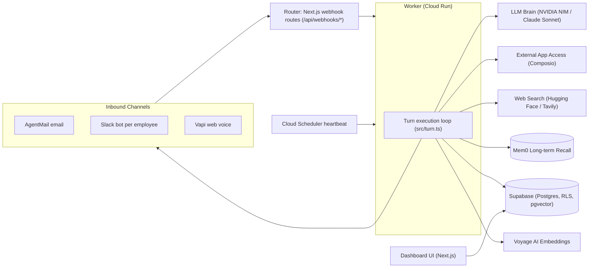

# Architecture

How the system is wired today. Product scope lives in [product.md](./product.md);
tables and field definitions in [data-model.md](./data-model.md).

## The flow: channels → router → worker → loop

**Inbound.** A message arrives on one of three webhook routes in `apps/web`
(`app/api/webhooks/agentmail`, `.../slack`, `.../vapi`). Each route verifies
the provider's signature, normalizes the payload to the shared `Envelope`
(`{org_id, employee_id, channel, text}`), acks fast, and dispatches the turn to
the worker in the background (`lib/worker.ts` → `POST /turn` with a `delivery`
descriptor so the worker replies on the originating channel).

Each route claims its delivery in `webhook_events` before doing any work, so a
provider redelivering the same event is ignored rather than answered twice, and
`check_rate_limit` bounds how often one sender can wake an employee (migration
0018).

**The worker** (`apps/worker`, single-bundle Docker image on Cloud Run) runs
one turn per request (`src/turn.ts`):

1. Log the inbound message to `events`.
2. Load the identity file, Mem0 recall, pgvector knowledge chunks, the
   employee's document inventory, and the last N events; assemble the system
   prompt (`src/prompt.ts`). Each enhancement is best-effort — a recall,
   knowledge, or document-list failure degrades the prompt, never sinks the
   reply; a document-list failure renders as "can't check right now", never as
   "no documents" (#165).
3. Call Claude (Sonnet) with the employee's Composio tools plus the built-in
   `read_document` and `send_message` tools attached. `send_message` always permits the manager and permits another email recipient only on a manager-originated turn, looping on `tool_use` up to a per-turn token
   budget (round-trip count is a runaway-loop backstop only, #125). `read_document`
   survives a Composio outage — it runs locally, not through a Composio session
   (#165). Every tool call is logged as an `events` row. If the budget is
   exhausted, one final tool-free call forces a real summary of what was done
   and what's left, instead of dropping the task silently.
4. Reply on the originating channel (`src/deliver.ts`), log the outbound
   message with token usage in the payload, and write new recall to Mem0 when
   the turn produced something worth remembering (#153).

If a Slack or email turn runs past 10s, the worker sends a short, model-generated
"still working on it" notice before the real reply (`src/notice.ts`, #124).

**Implementation note:** the worker uses the plain Anthropic SDK with a
hand-rolled tool loop, not the Claude Agent SDK. Composio tools attach via
`@composio/anthropic` (Messages-API tool format) rather than hosted MCP,
because Composio's MCP endpoint needs custom auth headers the connector can't
send. Calls run through the session's own `execute()`, not the provider's
`handleToolCalls` helper, which hit a sessionless endpoint and returned empty
results for session-only tools (#115). Scoping is structural: the Composio "user" is the
employee id, so a turn can only ever see that employee's OAuth grants.

**Heartbeat.** Cloud Scheduler POSTs `/heartbeat` at 09:00, 13:00 and 17:00
America/New_York on weekdays (#147); the worker acks 202 and fans out a
follow-up turn to every hired employee on the normal turn path, so heartbeat
activity shares memory, tools, and the event log. Its prompt is the same fixed
string every beat, so it recalls against pending commitments rather than that
prompt, and writes to Mem0 only when it acted — otherwise thousands of "nothing
happened" memories bury the real ones (#153). One sweep is `N employees ×
runTurn`, so the cadence is the main cost lever — see §Operations reference.

**Voice.** A Vapi assistant per employee, created at hire, runs the call on
Vapi's own Anthropic LLM. The system prompt is not frozen at hire: at call
creation the web app asks the worker's `POST /context` for a freshly assembled
prompt (identity, Mem0 recall, knowledge, recent conversation from the other
channels — `src/context.ts`) and injects it via `assistantOverrides` (#119).

Calls arrive two ways and both inject that same bundle. In-platform calls are
created server-side by `POST /api/employees/[id]/call`. Employees given a phone
number (#252) also take calls on it: the number is bought with no assistant
attached, so Vapi asks `/api/webhooks/vapi` who should answer, and the
`assistant-request` reply names the assistant and carries the overrides. Vapi
drops the call if that answer takes longer than 7.5 seconds, so the context
fetch has a 5s deadline and falls back to the assistant's stored prompt.
The prompt tells the employee it cannot take actions mid-call and must promise
them for after. When the call ends, the `end-of-call-report` webhook runs ONE
normal turn over the transcript — that is the only turn a call produces, so
the call lands in `events` and Mem0 without streaming per-utterance rows into
the profile's execution history (#157).

The pre-hire interview (before an assistant is provisioned) runs on a
transient inline assistant with no webhook, so it produces no event or worker
turn; its transcript is instead written straight to the new employee's Mem0
once the row exists (#143).

**Slack.** One Slack app per employee, created from a manifest at hire with the
org's App Configuration Token (`org_connectors.credential`; #48 — it expires
every 12h and rotates, so it cannot be an env var), installed once by an admin
via OAuth (`app/api/slack/oauth`). The events webhook is a single endpoint for
every employee's app, verifying each request with the owning app's signing
secret.

**Connectors.** Every channel and app an employee reaches is one row of the same
shape (#250): `org_connectors` says what a client has turned on,
`employee_connectors` what one employee holds, and
`packages/shared/src/connectors.ts` is the registry describing each — its
direction, identity, credential source, and how it is reached. Inbound routing
is one `(provider, address)` lookup for all three webhooks; hire loops the org's
connectors instead of calling a provisioner per vendor; the worker attaches a
toolkit only when both rows are `active`. Adding a connector is a registry entry
plus a handler in `apps/web/lib/connectors` (setup and teardown) and
`apps/worker/src/deliver.ts` (replies) — no schema work. Table shapes and the
RLS split are in [data-model.md](./data-model.md).

## The seams (`packages/shared`)

Cross-app contracts every layer builds behind. **Changing a signature requires
lead sign-off** (see CONVENTIONS.md).

| Seam | What it is for | Concrete implementation |
|---|---|---|
| `Envelope` | The normalized inbound message every channel produces and the worker consumes | `src/envelope.ts` |
| `IdentityFile` | The soul-file shape stored in `employees.identity` and rendered into the system prompt | `src/identity.ts` |
| `MemoryClient` | Search recall before a turn, write after | Mem0 REST in `apps/worker/src/memory.ts`; stub without a key |
| `KnowledgeRetriever` | Retrieve relevant knowledge chunks at turn start | pgvector `match_knowledge` RPC in `apps/worker/src/knowledge.ts`; stub without Voyage/Supabase |
| `CONNECTORS` | What each connector is, so web and worker agree without a second copy | Registry in `src/connectors.ts`; handlers in `apps/web/lib/connectors` and `apps/worker/src/deliver.ts` |
| `EventLogger` | Append every step to `events` | `apps/worker/src/supabase.ts` |

`packages/shared` also carries the generated Supabase `Database` types, model
ids (`MODELS`), and the Voyage embedding helper (`embedTexts`, vector(1024),
matched to the `knowledge_docs.embedding` column — change provider and
dimension together).

## Hosting layout

| Where | What | Notes |
|---|---|---|
| **Vercel** (`apps/web`) | Dashboard, API routes, the three inbound webhooks, Supabase Auth | Project `digital-workforce` (the only one — #36), serving both environments via Production/Preview env scopes; CI in `.github/workflows/ci.yml` (lint → typecheck → build → tests, plus local Supabase RLS tests) |
| **Cloud Run** (`apps/worker`) | The turn loop | Services `ate-worker-prod` and `ate-worker-dev`, region `us-central1`; both need CPU-always-allocated (or min-instances ≥ 1) because delivery continues after the 202 ack |
| **Supabase** | Postgres + Auth + pgvector + Storage, RLS | System of record and tenant isolation; migrations in `supabase/migrations/` |

**Tenancy.** Every row carries `org_id`; RLS blocks cross-org reads, except
`org_connectors`, which has no policies at all because its credentials can reach
a customer's whole workspace (see data-model.md). Mem0 is scoped by
employee_id-as-agent (`employees.id` is globally unique, so no org scope is
needed — callers must pass an org-checked id). Composio grants are per employee.
No queue — webhooks call the worker directly.

**Auth.** Supabase Auth; login/signup post to `/api/auth/*` route handlers
(session cookie set server-side) and `lib/supabase/middleware.ts` gates every
non-public route. Two Vercel footguns are recorded in CLAUDE.md (GET handlers
must be side-effect free; enforce auth in middleware, not page `redirect()`).

## Operations reference

Where things live once deployed — reference, not instructions (setup work is
tracked as issues).

- **Two environments.** `main` is production and `dev` is development. They are
  separated at three layers and nowhere else: the Vercel environment
  (Production vs Preview env vars), the Supabase project, and the Cloud Run
  service. Everything else — every vendor account and API key — is shared.

  | | Production | Development | Local Development |
  |---|---|---|---|
  | Branch | `main` | `dev` | Feature branches |
  | Domain | [`https://ateai.vercel.app`](https://ateai.vercel.app) | [`https://dev-ateai.vercel.app`](https://dev-ateai.vercel.app) | `http://localhost:3000` |
  | Vercel Project | [`mohitdebians-projects/ate-ai`](https://vercel.com/mohitdebians-projects/ate-ai) | Same (`dev` branch) | N/A |
  | Cloud Run Service | `ate-worker-prod` | `ate-worker-dev` | `http://localhost:8080` |
  | Supabase Project | `foujdwxpvammlniqpzzg.supabase.co` | Shared / Branch instance | Local or Remote |
  | Search Engine (HF) | [`https://codeload-ai-employee-search-engine.hf.space`](https://codeload-ai-employee-search-engine.hf.space) | Same | Same |
  | Heartbeat job | `ate-heartbeat` | `ate-heartbeat-dev` | Manual trigger |
  | Vercel env scope | Production | Preview | `.env.local` |
  | AgentMail webhook | `ep_3Hq6aTS5RdXdP1pCc63JLVVDOVP` | `ep_3Hq6aQ9qQdIUuIWvGPQfgd53e8K` | N/A |

  Each worker holds its own `WORKER_SHARED_SECRET`, so neither environment can
  authenticate to the other's worker.
- **Branch → environment.** `main` is Vercel's *Production Branch* and serves
  `ateai.vercel.app` (alias `app.ate.ai`); `dev` is bound to `dev-ateai.vercel.app` (alias `dev.ate.ai`).
  Every other feature branch still gets its own throwaway preview URL — hire an
  employee from one and its callbacks are frozen to a URL that dies with the
  branch, so hire from a domain. Deployment Protection is off, so Slack OAuth
  callbacks reach previews — the reason a second project once existed (#36).
- **Worker deploys** via GitHub Actions
  (`.github/workflows/deploy-worker.yml`) on pushes touching `apps/worker` or
  `packages/shared`. The branch picks the service: `main` → `ate-worker-prod`,
  `dev` → `ate-worker-dev`; any other branch fails the deploy rather than
  guessing. CI authenticates to GCP with **Workload Identity Federation** (no
  stored key): GitHub secrets `GCP_PROJECT_ID`, `GCP_WIF_PROVIDER`,
  `GCP_SA_EMAIL`; deploy SA `github-deployer` with run.admin +
  artifactregistry.writer + serviceAccountUser + **cloudscheduler.admin** (the
  deploy also re-asserts the heartbeat schedule — without this role the deploy
  fails at that step); images in Artifact Registry repo
  `ate` (`us-central1` — region and repo name are constants in the workflow).
  Both services live in the same GCP project (see #176).
- **Worker runtime env** is set once on each Cloud Run service and survives CI
  deploys — no secret lives in the repo or CI. This is what keeps the two
  workers apart: each holds its own Supabase credentials and its own
  `WORKER_SHARED_SECRET`. `POST /turn`, `/heartbeat`, and `/context` are gated
  by that secret (`x-worker-secret` header); the service URL is public and this
  header is the auth.
- **Web runtime env** lives in Vercel project settings. **Production** scope
  points at the production Supabase and `ate-worker-prod`; **Preview** scope
  points at the development Supabase and `ate-worker-dev`, so `dev` and every
  feature branch share one development environment. A var must exist in both
  scopes or `must()` throws where it is missing. Changing a `NEXT_PUBLIC_*` var
  requires a redeploy (build-time inlining).

  A var scoped to both Production and Preview in Vercel is **one entry with one
  value** — `vercel env rm X production` deletes it for both. Per-environment
  values need a separate entry per scope.

  **CI blocks a PR whose target environment is missing a required var**
  (`.github/workflows/env-check.yml`): a PR into `dev` checks the development
  Vercel scope and `ate-worker-dev`, a PR into `main` checks production and
  `ate-worker-prod`. The required names live in `scripts/required-env.json`
  — deliberately not `.env.example`, which also lists vars that are optional
  (`PUBLIC_APP_URL` falls back to the request origin; the Composio, AgentMail,
  and Vapi keys degrade via `hasEnv`). Add a var there only when its absence
  breaks the environment. The check reads names only, never values.
- **Error alerting** uses Sentry. Set `SENTRY_DSN` in both Vercel scopes and on
  each worker; set `SENTRY_ENVIRONMENT` on each worker to match its service.
  Keep Sentry alert rules and their notification destination enabled for both
  environments — a DSN reports an error but does not page anyone by itself.
- **Slack app config token** is not an env var: it expires every 12h and
  rotates, so it lives in the org's `org_connectors` row and refreshes itself
  (#48). A pair is per (user, workspace), so two orgs sharing one means the
  first to rotate breaks the rest — each org needs its own, and each environment
  must be seeded by a different Slack user (#235, #240; #72 drops the hire-path
  dependency entirely). #250's migration copied the one platform pair onto every
  existing org, so orgs beyond the first fail loudly at their next hire until
  seeded. Each employee's signing secret and bot token live on its own
  `employee_connectors` row at install — there are no global Slack credentials
  (#71).
- **Webhooks point at the web app:**
  | Vendor | Channel | Production Webhook | Development Webhook |
  |---|---|---|---|
  | **Vapi** | Voice Calls | `https://ateai.vercel.app/api/webhooks/vapi` | `https://dev-ateai.vercel.app/api/webhooks/vapi` |
  | **AgentMail** | Inbound Email | `https://ateai.vercel.app/api/webhooks/agentmail` | `https://dev-ateai.vercel.app/api/webhooks/agentmail` |
  | **Composio** | App Triggers | `https://ateai.vercel.app/api/webhooks/composio` | `https://dev-ateai.vercel.app/api/webhooks/composio` |
  | **Slack** | Bot OAuth Redirect | `https://ateai.vercel.app/api/channels/slack/oauth` | `https://dev-ateai.vercel.app/api/channels/slack/oauth` |
  | **Cron / Heartbeat** | Periodic Sweeps | `https://ateai.vercel.app/api/cron/heartbeat` | `https://dev-ateai.vercel.app/api/cron/heartbeat` |
- **How webhooks find their environment.** Slack apps and Vapi assistants are
  created per employee at hire, capturing the deployment's own origin
  (`new URL(request.url).origin`), so they self-separate: an employee hired on
  `dev` calls back to `dev`. A phone number (#252) captures the same way but is
  bought from a button on the profile rather than at hire, so it can be pinned
  to whichever deployment the manager happened to have open — buy numbers on the
  environment's own domain, not on a per-commit preview URL. Setting
  `PUBLIC_APP_URL` guards against that only if it is set per Vercel scope; one
  entry scoped to both points both environments at the same place. **AgentMail does not** — `provisionInbox` sends no
  URL, so a webhook cannot be created per inbox at hire time. Instead there is
  **one webhook per environment**, each pointing at that environment's domain
  and holding its own signing secret (`AGENTMAIL_WEBHOOK_SECRET`, set per Vercel
  env scope). Both are account-wide: routing works because each deployment only
  finds `inbox_id` in *its* Supabase, and ignores anything else
  (the `(provider, address)` lookup returns nothing, the route 200s).

  AgentMail does support scoping a webhook to specific inboxes (`inbox_ids`, max
  10) with a secret per webhook, which would mirror Slack/Vapi. It is
  deliberately not used: an AgentMail webhook carries no per-employee identity
  (no bot token, no number) — it is only a routing rule — and per-inbox secrets
  would mean a per-employee column plus a lookup inside
  `verifyAgentmailSignature`, on the security-critical path, in exchange for a
  10-employee-per-environment ceiling. Two account-wide webhooks need no code at
  all.

  **Webhook URLs are immutable** — `PATCH /v0/webhooks/{id}` accepts
  `event_types` and inbox/pod subscriptions but not `url`, so moving a webhook
  means creating a new one (with a new secret) and deleting the old.
- **Hire-time URLs are frozen in vendor databases.** They capture whatever
  origin served the hire request, so employees hired against a preview URL keep
  calling that dead URL forever. Both environments now sit behind stable custom
  domains, which stops the drift at the source. Repointing an already-hired
  employee is possible but per-resource: Vapi via `PATCH /assistant/{id}`
  (sending `server` — the PATCH replaces that object wholesale, so the
  `x-webhook-secret` header must be re-sent), Slack via `apps.manifest.update`
  (which replaces the whole manifest, so it must be rebuilt as `createSlackApp`
  writes it; verified not to rotate `signing_secret` or invalidate bot tokens).
- **Heartbeat** is a Cloud Scheduler HTTP job POSTing `<worker>/heartbeat`
  with the `x-worker-secret` header — one job per environment, each carrying
  that environment's secret: `main` → `ate-heartbeat`, `dev` →
  `ate-heartbeat-dev`, picked by branch like `SERVICE`. **The schedule is
  declared in `deploy-worker.yml` (`HEARTBEAT_JOB` / `HEARTBEAT_SCHEDULE` /
  `HEARTBEAT_TIMEZONE`) and re-applied on every worker deploy** — edit it there,
  not in the console, or the next deploy reverts you. Every sweep runs a full
  turn per hired employee, so cadence is the cost lever: hourly 24/7 was 168
  sweeps/week; `0 9,13,17 * * 1-5` America/New_York is 15 (#147).
- **Env var inventory** lives in `apps/web/.env.example` and
  `apps/worker/.env.example`, one comment per var saying which service and
  where to get it.
- **Worker smoke test:** `GET /` returns `{"ok":true,"service":"<K_SERVICE>"}` —
  the Cloud Run service that answered (`ate-worker-prod` /
  `ate-worker-dev`), so the health check itself tells you which environment a
  URL reaches; off Cloud Run it reads `ate-worker (local)`.
  `POST /turn` without the secret returns 401; with the secret and a minimal
  envelope it returns `{"reply": ...}` and writes an `events` row. Boot logs
  (`gcloud run services logs read <service> --region us-central1`) show
  whether Anthropic/Supabase are configured.
- **Developer onboarding & full inventory:**
  For the step-by-step local setup guide, system topology flowcharts, and the complete categorized inventory of all 30+ environment variables and API keys, see [`docs/onboarding.md`](./onboarding.md).

