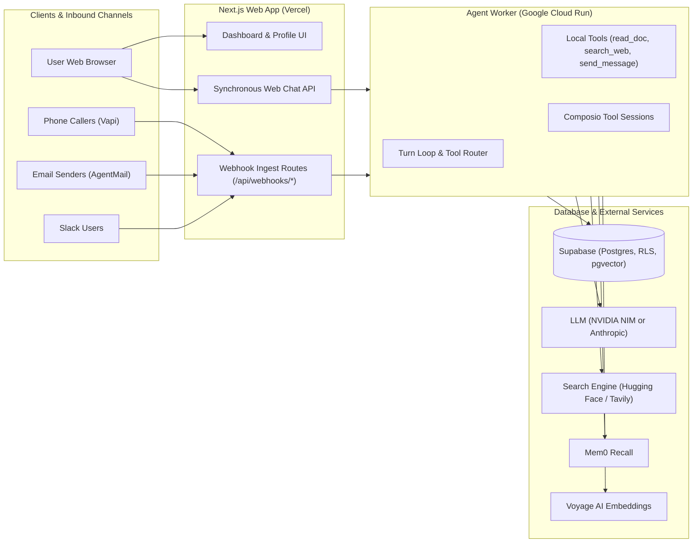

# Developer Onboarding & Infrastructure Reference

This document is the single source of truth for all infrastructure, environment URLs, third-party API keys, webhook endpoints, and development workflows for the **Ate.ai** digital workforce platform.

---

## 1. System Topology & Architecture

The platform consists of three core components:



1. **Web Application (`apps/web`)**: Next.js 15 App Router deployed on **Vercel**. Handles dashboard UI, authentication, employee provisioning wizard, and incoming vendor webhooks.
2. **Worker Service (`apps/worker`)**: Stateless Node.js service running on **Google Cloud Run**. Executes the turn loop, system prompt assembly, tool calls, LLM communication, and memory writing.
3. **Database (`Supabase`)**: PostgreSQL database with Row Level Security (RLS), Supabase Auth, and `pgvector` for document embeddings.

---

## 2. Environments & URLs Directory

| Resource | Production | Development / Preview | Local Development |
| :--- | :--- | :--- | :--- |
| **Web Dashboard** | [`https://ateai.vercel.app`](https://ateai.vercel.app) | [`https://dev-ateai.vercel.app`](https://dev-ateai.vercel.app) | `http://localhost:3000` |
| **Cloud Run Worker** | `ate-worker-prod` | `ate-worker-dev` | `http://localhost:8080` |
| **Git Branch** | `main` | `dev` | Feature branches off `dev` |
| **Vercel Project** | [`mohitdebians-projects/ate-ai`](https://vercel.com/mohitdebians-projects/ate-ai) | Same (Preview branch = `dev`) | N/A |
| **Vercel Domains** | [Domains Settings](https://vercel.com/mohitdebians-projects/ate-ai/settings/domains) | Valid config (`dev-ateai.vercel.app`) | N/A |
| **Vercel Env Vars** | [Environment Variables](https://vercel.com/mohitdebians-projects/ate-ai/settings/environment-variables) | Set per Production / Preview scope | `.env.local` |
| **Supabase Project** | `foujdwxpvammlniqpzzg.supabase.co` | Shared / Branch instance | Local or Remote instance |
| **Search Engine (HF)** | [`https://codeload-ai-employee-search-engine.hf.space`](https://codeload-ai-employee-search-engine.hf.space) | Same | Same |

### Git Remotes
* **`origin`** (Primary Team Repo): `https://github.com/ate-io/ate.ai.git`
* **`personal`** (Deployment Fork): `https://github.com/mohitdebian/ate.ai.git`

---

## 3. Webhooks & Redirect URIs Directory

When setting up vendor accounts or debugging inbound channels, copy the exact URL matching your target environment:

| Vendor | Channel | Production URL | Development / Preview URL | Destination Handler |
| :--- | :--- | :--- | :--- | :--- |
| **Vapi** | Voice Calls | `https://ateai.vercel.app/api/webhooks/vapi` | `https://dev-ateai.vercel.app/api/webhooks/vapi` | `apps/web/app/api/webhooks/vapi/route.ts` |
| **AgentMail** | Email | `https://ateai.vercel.app/api/webhooks/agentmail` | `https://dev-ateai.vercel.app/api/webhooks/agentmail` | `apps/web/app/api/webhooks/agentmail/route.ts` |
| **Composio** | App Triggers | `https://ateai.vercel.app/api/webhooks/composio` | `https://dev-ateai.vercel.app/api/webhooks/composio` | `apps/web/app/api/webhooks/composio/route.ts` |
| **Slack** | Bot OAuth | `https://ateai.vercel.app/api/channels/slack/oauth` | `https://dev-ateai.vercel.app/api/channels/slack/oauth` | `apps/web/app/api/channels/slack/oauth/route.ts` |
| **Cron / Heartbeat** | Scheduler | `https://ateai.vercel.app/api/cron/heartbeat` | `https://dev-ateai.vercel.app/api/cron/heartbeat` | `apps/web/app/api/cron/heartbeat/route.ts` |

> [!TIP]
> For local testing with real webhooks, run `ngrok http 3000` or use a Cloudflare Tunnel, then replace the domain with your temporary tunnel domain (e.g. `https://xyz.ngrok-free.app/api/webhooks/vapi`).

---

## 4. Complete API Keys & Environment Variables Inventory

### A. Core Platform & Database (Supabase)
| Variable | Description | Where to Get | Set In |
| :--- | :--- | :--- | :--- |
| `NEXT_PUBLIC_SUPABASE_URL` | Supabase API endpoint (`https://foujdwxpvammlniqpzzg.supabase.co`) | Supabase Settings → API | Web & Worker |
| `NEXT_PUBLIC_SUPABASE_ANON_KEY` | Public client key (subject to RLS policies) | Supabase Settings → API | Web |
| `SUPABASE_SERVICE_ROLE_KEY` | Admin key (bypasses RLS). **Never expose to client.** | Supabase Settings → API | Web & Worker |

### B. LLM Inference Providers
The platform supports either **NVIDIA NIM** (free tier) or **Anthropic Claude**. If `NVIDIA_API_KEY` is present, Ate routes turns and tool-calling to NVIDIA NIM.
| Variable | Description | Where to Get | Set In |
| :--- | :--- | :--- | :--- |
| `NVIDIA_API_KEY` | NVIDIA NIM API key (`nvapi-...`) | [build.nvidia.com](https://build.nvidia.com) → API Keys | Web & Worker |
| `NVIDIA_MODEL` | (Optional) Text model override (default: `nvidia/nemotron-3-ultra-550b-a55b`) | NVIDIA NIM docs | Web & Worker |
| `NVIDIA_VISION_MODEL` | (Optional) Vision model override (default: `nvidia/nemotron-3.5-super-vl-120b-a12b`) | NVIDIA NIM docs | Web & Worker |
| `ANTHROPIC_API_KEY` | Anthropic Claude API key (`sk-ant-...`) | [console.anthropic.com](https://console.anthropic.com) | Web & Worker |

### C. Inter-Service Communication & Public Origin
| Variable | Description | Notes | Set In |
| :--- | :--- | :--- | :--- |
| `PUBLIC_APP_URL` | Base HTTPS origin for vendor OAuth redirects and callbacks | Set to `https://ateai.vercel.app` (Prod) or `https://dev-ateai.vercel.app` (Dev) | Web |
| `WORKER_URL` | URL of the Cloud Run worker (`https://ate-worker-prod-...` or `http://localhost:8080`) | Webhook routes dispatch turns to this address. | Web |
| `WORKER_SHARED_SECRET` | 32-byte hex string gating `POST /turn` and `POST /context` | Generate with `openssl rand -hex 32`. Must match exactly on both services. | Web & Worker |

### D. Live Web Search Tool (`search_web`)
The worker has a native web search tool that supports either an open-source search engine or Tavily:
| Variable | Description | Where to Get | Set In |
| :--- | :--- | :--- | :--- |
| `SEARCH_ENGINE_URL` | Custom search engine URL (e.g. `https://codeload-ai-employee-search-engine.hf.space` or SearXNG) | Your Hugging Face Space or self-hosted SearXNG URL | Worker |
| `SEARCH_ENGINE_TOKEN` | (Optional) Bearer token (`hf_...`) if your Hugging Face Space is Private | Hugging Face Settings → Access Tokens | Worker |
| `TAVILY_API_KEY` | (Optional) Tavily Search API key (1,000 free searches/month) | [tavily.com](https://tavily.com) | Worker |

### E. Voice Calling Channel (Vapi)
| Variable | Description | Where to Get | Set In |
| :--- | :--- | :--- | :--- |
| `VAPI_API_KEY` | Vapi Private API Key | [vapi.ai](https://vapi.ai) dashboard → API Keys | Web & Worker |
| `NEXT_PUBLIC_VAPI_PUBLIC_KEY` | Vapi Public Key (used for browser in-dashboard test calls) | Vapi dashboard → API Keys | Web (build-time) |
| `VAPI_WEBHOOK_SECRET` | Secret sent in `x-webhook-secret` on call events | Any random string generated by team | Web |
| `VAPI_AREA_CODE` | (Optional) Area code for provisioning phone numbers (default: `972`) | US Area Code | Web |

### F. Email Channel (AgentMail)
| Variable | Description | Where to Get | Set In |
| :--- | :--- | :--- | :--- |
| `AGENTMAIL_API_KEY` | AgentMail API Key (provisions employee inboxes and sends replies) | [agentmail.to](https://agentmail.to) → API Keys | Web & Worker |
| `AGENTMAIL_WEBHOOK_SECRET` | Webhook verification secret (`whsec_...`) | AgentMail dashboard → Webhooks | Web |

### G. App Integrations & OAuth (Composio)
| Variable | Description | Where to Get | Set In |
| :--- | :--- | :--- | :--- |
| `COMPOSIO_API_KEY` | Composio API Key (powers ~1000 app connectors in App Access) | [app.composio.dev](https://app.composio.dev) → Settings | Web & Worker |
| `COMPOSIO_WEBHOOK_SECRET` | Webhook verification secret | Composio V3 Dashboard | Web |

### H. Memory, Knowledge & Embeddings
| Variable | Description | Where to Get | Set In |
| :--- | :--- | :--- | :--- |
| `MEM0_API_KEY` | Mem0 API Key (semantic long-term memory across channels) | [app.mem0.ai](https://app.mem0.ai) → API Keys | Web & Worker |
| `VOYAGE_API_KEY` | Voyage AI Key (generates 1024-dimension embeddings for knowledge docs) | [dash.voyageai.com](https://dash.voyageai.com) | Web & Worker |
| `KNOWLEDGE_MIN_SCORE` | (Optional) Cosine similarity threshold for RAG retrieval (default: `0.3`) | Tuning parameter | Worker |

### I. Observability & Monitoring (Sentry)
| Variable | Description | Where to Get | Set In |
| :--- | :--- | :--- | :--- |
| `SENTRY_DSN` | Sentry DSN client key | [sentry.io](https://sentry.io) → Project Settings | Web & Worker |
| `SENTRY_ENVIRONMENT` | Environment tag (`production` or `development`) | Manual | Web & Worker |

---

## 5. Local Development Quickstart

### Prerequisites
* **Node.js**: `v22.x` (or newer)
* **pnpm**: `v9.x` (`corepack enable && corepack prepare pnpm@latest --activate`)

### 1. Clone & Install
```bash
git clone https://github.com/ate-io/ate.ai.git
cd ate.ai
pnpm install
```

### 2. Configure Environment Files
```bash
# Web application configuration
cp apps/web/.env.example apps/web/.env.local

# Worker runtime configuration
cp apps/worker/.env.example apps/worker/.env
```
Fill in the values in `apps/web/.env.local` and `apps/worker/.env` using the secrets from your team's password manager.

### 3. Run Development Servers
* **Run Web Application (Port 3000):**
  ```bash
  pnpm dev
  ```
* **Run Worker Service (Port 8080):**
  ```bash
  pnpm --filter @ate/worker dev
  ```

### 4. Running Quality Checks
Before submitting PRs, ensure all checks pass:
```bash
pnpm typecheck   # Typecheck TypeScript across all packages
pnpm lint        # Run ESLint across monorepo
pnpm test        # Run all unit tests (104+ tests)
```

---

## 6. Branching & Deployment Strategy

* **`dev` Branch:**
  * Active development and PR integration branch.
  * Pushing to `dev` automatically deploys preview builds to `https://dev-ateai.vercel.app` and `ate-worker-dev`.
* **`main` Branch:**
  * Stable production branch.
  * Pushing to `main` automatically deploys to `https://ateai.vercel.app` and `ate-worker-prod`.
* **Database Migrations:**
  * Located in `supabase/migrations/`.
  * Applied to the Supabase project using the Supabase CLI (`supabase db push`).
